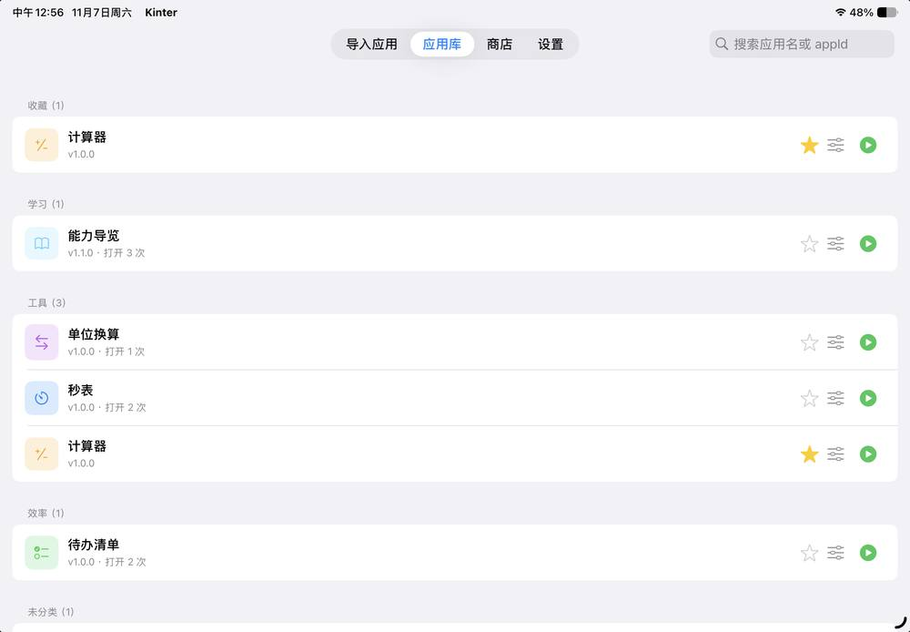
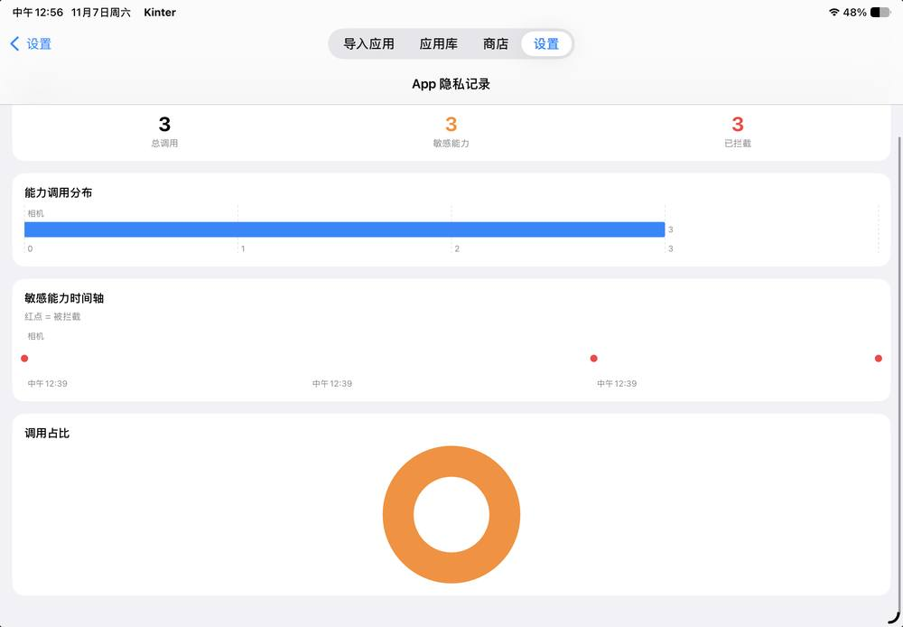

# 🧩 Kinter

**一个把 iPhone / iPad 变成「小程序运行时」的开源宿主**

不是又一个 App。Kinter 更像一台你可以拆开看的小机器：把一个小程序打包成 ZIP 丢进去，它就能在系统里跑起来，并且真的能用相机、相册、定位、蓝牙、日历、健康数据这些原生能力。

我做完之后一直问自己一个问题：这些能力如果谁都能偷偷调用，那它就是个后门。所以这个项目一半的力气花在了另一件事上——**让每一次调用都被看见、被拦下、被记录**。这就是里面的「安全模式」。




---

## ✨ 现在已经能跑起来的东西

### 📦 宿主本体
- ✅ 基于 `WKWebView` 的小程序运行环境，页面用 HTML 写就行
- ✅ ZIP 包导入安装，`manifest.json` 写清名字、版本、要用的能力
- ✅ 50 项原生能力，通过统一的 `wx.*` Promise 接口调用
- ✅ 多实例多窗口，同一个 App 里能同时开好几个小程序
- ✅ 页面栈路由，最多 10 层，带参数传递和返回栈
- ✅ KTML 声明式模板（`column` / `text` / `for` / `if` + `{{ }}` 绑定），不想写 HTML 也能做界面
- ✅ 能力调用异常隔离：某个能力炸了，宿主不跟着炸

### 🧠 能力网关（50 项）
- ✅ 没在 `manifest.json` 里声明的能力，调用直接返回 `capability_not_declared`
- ✅ 按 L0 / L1 / L2 分级：无授权、系统弹框、需要开发者资质
- ✅ 系统权限统一收口，20 类 `scope.*` 可以查询、申请、被拒后引导去设置
- ✅ 每个会话独立网关实例，两个小程序不会串状态
- ✅ 全量审计日志

### 🛡 安全模式（这个项目最想讲的一件事）
- ✅ 默认拒绝，不是默认放行
- ✅ 三级策略：高危 / 常规 / 联网，各自不同待遇
- ✅ 拦截时顶部出橙色卡片，**两个按钮摆在你面前**：「允许本次」「以后都允许」
- ✅ 一次性令牌：允许一次 = 只放行一次，不给你偷偷续期
- ✅ 组合规则：刚读过剪贴板、5 秒内又往外发数据，直接判定可疑并拦下
- ✅ 隐私记录页：总调用 / 敏感能力 / 已拦截 / 能力分布 / 时间轴红点 / 占比环图
- ✅ 每次调用落盘成 JSONL，能在「文件」App 里直接翻



### 🎨 应用库
- ✅ 分类分组，收藏区固定置顶
- ✅ 星标收藏、0–5 星评分、打开次数与累计时长
- ✅ 搜索：按名称 / appId / 分类实时过滤
- ✅ 左滑收藏、左滑卸载
- ✅ SF Symbol 图标：manifest 里写 `iconSymbol` + `iconColor`，不用准备图片
- ✅ 每个小程序一个「管理」页：分类、评分、使用统计、桌面开关、权限清单、卸载

### 🧭 能力导览（随包附赠的一本手册）
- ✅ 50 项能力归成 45 个条目，逐条讲清四件事：能干什么、会弹什么框、被拒了怎么办、什么设备上不好使
- ✅ 按 Apple 手册的排布重写过：大标题、图文分块、可展开条目
- ✅ 完全离线，页面里不含任何网络请求

### 🏪 商店与分发
- ✅ 静态商店源：`StoreTools/build_index.py` 生成 `index.json`，扔到 GitHub Pages 就能用
- ✅ 版本比较、SHA256 校验、下载安装
- ✅ 付费小程序：manifest 声明售价，商店展示价格，购买后解锁
- ✅ 发布接口设计好了（`/api/apps/publish`），后端可以自己接

### 🤖 让 AI 帮你写小程序
- ✅ 接 OpenAI 兼容接口，说一句话就生成一个小程序包
- ✅ 生成完还能继续对话改，不满意就重新生成

### 📱 系统集成
- ✅ Live Activity（锁屏 / 灵动岛）
- ✅ Siri 快捷指令
- ✅ Spotlight 索引
- ✅ 用 URL Scheme 唤起别的 App，`wx.canOpenURL` 先预检

### 🛠 调试
- ✅ 运行页导航栏的仪表盘图标：FPS、桥接调用与失败数、JS 错误、窗口数、运行时长
- ✅ 一键请求全部系统权限（13 项一次跑完），做权限矩阵回归

---

## 🛡 安全模式到底怎么判断

小程序调一次能力，要依次过这几关：

```text
小程序 JS  →  BridgeMessageHandler  →  CapabilityGateway
                                        ├─ ① manifest 里声明了吗
                                        ├─ ② 你在管理页手动关掉了吗
                                        ├─ ③ 安全模式：三级判定 + 组合规则
                                        ├─ ④ 系统权限（iOS 自己的授权框）
                                        ├─ ⑤ 调用并记录
                                        └─ ⑥ 异常隔离，失败也不崩宿主
```

三级是这样分的：

| 档位 | 能力 | 策略 |
|---|---|---|
| 高危 | 通讯录、健康数据、麦克风、语音识别、录像、剪贴板、陀螺仪、日历、提醒 | 默认拒，只给「允许本次」，不提供永久授权 |
| 常规 | 相机、相册、保存到相册、定位、蓝牙、蓝牙扫描 | 默认拒，可「允许本次」，也可「以后都允许」 |
| 联网 | HTTP、上传、WebSocket | 放行但记录；刚调过高危能力 5 秒内出现，会被拦下 |

判定表在 `HostApp/Runtime/Security/SecurityPolicy.swift`，是唯一来源。拦截点在网关最底层，不管调用方是小程序、Agent 还是别的什么，都绕不过去。

---

## 📲 装到设备上

三种方式，挑顺手的。

**① 直接下 IPA（最快）**

[Releases 页面](https://github.com/KFZ342/kinter-open-source/releases/latest) 里下 `Kinter-unsigned.ipa`。

- TrollStore：直接装
- SideStore / AltStore / Sideloadly：自签安装
- 装完第一次启动前，记得开「设置 → 隐私与安全性 → 开发者模式」

**② 自己编译**

```bash
git clone https://github.com/KFZ342/kinter-open-source.git
cd kinter-open-source
brew install xcodegen
xcodegen generate --spec Tools/project.yml
open Kinter.xcodeproj
```

选好设备，`Cmd + R`。

**③ 命令行出未签名包**

```bash
chmod +x Tools/build_unsigned_ipa.sh
./Tools/build_unsigned_ipa.sh Release
```

产物在 `build/Kinter-unsigned.ipa`。推一个 tag 也会自动触发 GitHub Actions 出包。

第一次打开，宿主会自己装好 5 个示例：计算器、待办清单、秒表、单位换算、能力导览。不用先学会打包，点开就能看到东西在动。

---

## 🧩 写一个自己的小程序

一个 ZIP，根目录一个 `manifest.json`、一个 `index.html`，就够跑。

```json
{
  "appId": "com.example.hello",
  "name": "示例应用",
  "version": "1.0.0",
  "pages": ["index"],
  "iconSymbol": "sparkles",
  "iconColor": "#FF9F0A",
  "capabilities": ["camera", "vibrate", "storage"]
}
```

里面怎么调能力：

```js
wx.chooseImage({ count: 1 })
  .then(res => console.log(res.tempFilePaths))
  .catch(err => console.error(err.code))
```

不想写 HTML，就写 KTML：

```xml
<column padding="20" gap="16">
  <text size="xxl" weight="bold">{{ title }}</text>
  <for each="item in items" key="id">
    <row>
      <text>{{ item.name }}</text>
      <text color="muted">¥{{ item.price }}</text>
    </row>
  </for>
</column>
<script>
var title = '水果';
var items = [{ id: 1, name: '苹果', price: '8.5' }];
</script>
```

界面看不懂的时候，去翻随包的能力导览——每一项都写了在什么设备上会不好使。

---

## 🗺 仓库结构

```text
ActivityWidget/    Live Activity 小组件扩展
DemoApps/          示例小程序（ZIP + 源文件，可导入宿主）
HostApp/           宿主 App：Runtime / Core / AI / Auth / UI / Intents / Store
  Runtime/
    Gateway/       能力网关 + 50 个 Provider
    Security/      安全模式：分级、拦截、令牌、信任、落盘
    Support/       ObjCExceptionCatcher 等底层支撑
  UI/
    Security/      橙色横幅、隐私记录图表
SDK/               wx.js（桥接 SDK）、ktml.js（模板编译器）
StoreTools/        静态商店源构建（build_index.py）
Tools/             xcodegen spec、未签名 IPA 构建脚本
docs/              CAPABILITIES / KTML / WX_API / DEPLOY / ROADMAP
SIGNING.md         自签安装指引
```

---

## 🧪 这个版本还做不到的事

写在这里，省得你踩了以为是 bug。

- **有 6 个模块绕过网关**：页面跳转、应用商店、登录、应用管理、弹窗、权限设置直接在桥接层 `return`，安全模式管不到它们
- **组合规则只有 5 秒窗口**：读完剪贴板等 6 秒再联网就检测不到，要彻底可靠得改成按行为链追踪
- **判定表只覆盖 25 项**：剩下 25 项能力还没进分级表，目前按「非敏感」处理
- **WebView 没有导航策略**：远程页面加载进来后，也能向桥发消息
- **健康数据、Live Activity 要 entitlement**：自签名包拿不到，调用会老实返回「不支持」（不会闪退）
- **模拟器上很多能力用不了**：相机、面容、语音识别、实时活动都不支持，这是预期行为
- **同层渲染没做**：部分能力还是全屏 picker
- **没有内置后端**：不接认证服务器时，登录、发布这些功能是用不了的

---

## 🤝 想一起改

- 加一项能力：在 `HostApp/Runtime/Gateway/Providers/` 新建 Provider，去注册中心登记，再去 `SecurityPolicy` 里把它归到某一档
- 加一个 JS API：改 `SDK/wx.js`，顺手更新 `docs/WX_API.md`
- 补文档：`docs/` 下面随便挑

提 PR 之前不用问我风格，写清楚「为什么这么改」就行。

---

## 📄 许可

[GNU AGPL-3.0](LICENSE)。

商用、修改、分发都可以，但拿它做成商业产品/服务，得把对应源码按同样协议公开。

---

## 最后

这套东西最早是给自己用的：不想为了验证一个想法，去 Xcode 里改半天原生代码。后来能做的越来越多，问题也来了——能力给得越多，谁在什么时候用了什么，就越说不清。安全模式是为此补上的，能力导览也是。它们不算炫技，只是让这东西敢给别人用。

如果你也在 iPad 上折腾小程序、或者单纯想看看「一个 App 能有多少种原生能力」，欢迎拿走玩。
